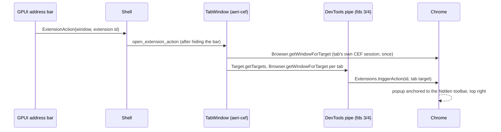

# GPUI and CEF integration

Status: Phase 0. Decision: [ADR 0002](../decisions/0002-rendering-strategy.md),
accepted and gated by spike S1. Evidence: [`cef.md`](../research/cef.md) and
[`gpui.md`](../research/gpui.md). Section numbers below point into those
files. Labels follow the research: Observed, Reported, Inferred.

## Facts that fix the design (macOS)

1. **Two runtime styles.** CEF has Chrome style and Alloy style. Chrome
   style has Chrome's UI layer: Web Store install, extension popups,
   `tabs`/`windows` APIs, permission and passkey prompts. Alloy style runs
   extension scripts but has no tab model and no UI. Observed
   ([cef.md §3, §4.1](../research/cef.md)).
2. **Chrome style is Views-only on macOS.** A browser given a `parent_view`
   (a foreign `NSView`) or rendered off-screen is forced to Alloy style.
   Issue #3294 is open. Observed in source
   ([cef.md §3](../research/cef.md)).
3. **Native children cover GPUI.** GPUI draws everything into one Metal layer
   on its content view. A native view added as a child always covers GPUI
   drawing in its bounds, including slide-in panels. Stock GPUI has no
   composition API. Observed ([gpui.md Q4](../research/gpui.md)).
4. **Off-screen rendering is costly and Alloy-only.** Frames reach GPUI
   through a CPU copy. Zero-copy needs a GPUI patch. Observed
   ([gpui.md Q5](../research/gpui.md)).
5. **Aeri can reach the `NSWindow`.** `CefWindow::GetWindowHandle()` returns
   the window's content view on macOS. Chrome-style Views windows can be
   frameless and can drop the Chrome toolbar (`CEF_CTT_NONE`). Observed
   ([cef.md §3](../research/cef.md)).

## Options

| Option | Summary | Verdict |
| --- | --- | --- |
| A | Alloy browser inside a GPUI window. Aeri builds its own install and popup UI. | Fallback 2. Breaks password-manager extensions. Needs owner approval. |
| **B** | **Frameless Chrome-style CEF Views window. GPUI windows attached as transparent child windows.** | **Chosen.** Gated by S1. |
| C | GPUI view added inside the CEF window's content view. | Fallback 1. Needs GPUI to attach to a foreign `NSView`. |
| D | Off-screen rendering into GPUI. | Rejected: Alloy-only, CPU copy per frame. |
| E | Patched, self-built CEF (#3294 or a revived extension API). | Rejected: Aeri would own a Chromium build. Revisit only for codecs ([ADR 0005](../decisions/0005-media-codecs-and-drm.md)). |

Option analysis: [ADR 0002](../decisions/0002-rendering-strategy.md) and
[cef.md §4.4](../research/cef.md).

**Fallback order if S1 fails:** C, then A. Moving to A changes the
first-release extension promise, so the owner must approve it. Stop and
report before taking either step.

## Window composition (option B, as built in Phase 1)

S1 changed the layering; see
[ADR 0002 "S1 outcome"](../decisions/0002-rendering-strategy.md#s1-outcome-phase-1-2026-11-18).

```text
  address bar   GPUI child window (pop-up kind, re-levelled to the frame)
  active tab    borderless CefWindow, child window inset below the strip
  other tabs    CefWindows, ordered out
  frame         GPUI window: the strip (traffic lights, back, forward,
                reload); size, position, minimise, full screen, Space
```

- **One tab, one CEF window.** A Chrome-style window hosts exactly one
  browser view for its lifetime (Observed). `aeri-cef::TabWindow` creates
  the window and hands its content `NSView` to a `TabObserver`.
- **`apps/aeri/src/mac/frame.rs` (`Frame`)** owns the AppKit side:
  - `addChildWindow` for tabs and the address bar;
  - refitting children on `NSWindowDidResize` and the full-screen
    notifications;
  - ordering the active tab in and the previous one out;
  - styling tab windows as borderless rounded cards with no buttons, and
    keeping the frame's active look while a child is key
    (`_sharesParentKeyState`);
  - forcing overlay scrollbars for pages (`preferredScrollerStyle`);
  - forwarding key status when the frame itself becomes key.
- **Stock GPUI has no `addChildWindow` call**, and its pop-up kind uses a
  global float level ([gpui.md Q4](../research/gpui.md)). Aeri attaches
  the child after `open_window` and resets its level to the frame's.
- **Transparent GPUI pixels do not pass clicks** (Observed). Overlays are
  sized to their content and ignore the mouse while hidden. A pinned or
  sliding sidebar (Phase 6) needs the same treatment, or per-region
  `ignoresMouseEvents`.
- **Re-entrancy.** AppKit calls on GPUI windows (move, resize, key) fire
  GPUI callbacks that need the `App` borrow. The shell runs every AppKit and
  CEF side effect after `cx.update` returns (`Shell::later`).
- **Chrome-created tabs.** Chrome opens its own Chrome-UI window for tabs it
  creates (CDP `Target.createTarget`, and so `chrome.tabs.create`). Phase 2
  routes these into Aeri tabs.
- **Background tabs** ([ADR 0007](../decisions/0007-tab-signals.md)). A
  link opened in a background tab gets no CEF window until first shown.
  Hidden tab windows are ordered out, and Chromium throttles them on its own.
  Sound is reported by Aeri's bundled tab-signals extension over the private
  DevTools pipe; camera and microphone by `OnMediaAccessChange`.
- **Extension popups.** These anchor to Chrome toolbar views. With no
  toolbar, Aeri may need `CEF_CTT_LOCATION` or `CEF_CTT_NORMAL` hidden behind
  its own UI, or `Extensions.triggerAction`
  ([cef.md §4.1, §4.4](../research/cef.md)). Popup delay is a known upstream
  issue (#4350, Reported).

## Run-loop integration

GPUI owns `[NSApp run]` ([gpui.md Q6](../research/gpui.md)). CEF is
initialised after GPUI has created its `NSApplication` subclass, with
`external_message_pump = true` and `multi_threaded_message_loop = false`
([cef.md §8](../research/cef.md)).

1. `OnScheduleMessagePumpWork(delay_ms)` may arrive on any thread. It stores
   the deadline atomically and wakes the main run loop.
2. A Core Foundation timer plus a thread-safe source run on the main run
   loop in the **common** and **event-tracking** modes. Event-tracking mode
   keeps web content alive during live resize and menu tracking. CEF's own
   sample pump uses the same modes ([cef.md §8](../research/cef.md)).
3. The callback calls `CefDoMessageLoopWork()` **outside any GPUI `App`
   borrow**. Calling it inside `cx.update` re-enters GPUI's paint callbacks
   ([gpui.md Q6](../research/gpui.md)).
4. Do not schedule the pump through GPUI's executors. The one prototype
   (bokuweb/gpui-cef) saw ticks every one to five seconds when idle
   (Reported by its author, not reproduced).
5. `CefAppProtocol` (`isHandlingSendEvent`) is added to GPUI's
   `NSApplication` subclass at runtime with `objc2`. GPUI offers no hook to
   subclass or configure it ([gpui.md Q6](../research/gpui.md)).
   `applicationShouldTerminate:` is added to GPUI's app delegate, so a quit
   from the Dock, the app menu or logout runs the orderly quit first.
6. Quit: close every tab window (the browser closes first), remove the GPUI
   windows, stop the pump, `CefShutdown`, then let `terminate:` through.
   Observed: no Aeri process remains 0.5–1.5 s after Cmd-Q, the close
   button or an Apple-event quit.

GPUI itself keeps painting during live resize
([gpui.md Q6](../research/gpui.md)). Whether main-queue work and the CF
source keep running during a tracking loop is Inferred and tested in S3.

The pump must not become a fixed 60 Hz timer. A fixed timer defeats GPUI's
idle pause on macOS 14+ ([gpui.md Q9](../research/gpui.md)). The pump runs
when CEF asks for work. Its fallback tick is cefclient's 30 Hz while CEF
asks for immediate work, and 4 Hz once it has asked for none for about a
second (`mac/pump.rs`); a request with a delay still fires on time.

## Input and focus hand-off

Two windows mean two first responders ([gpui.md Q7](../research/gpui.md)).

- The page has the keyboard when its tab window is key. The address bar has
  it when its GPUI window is key. `Frame` moves key status explicitly with
  `makeKeyWindow`, then calls `TabWindow::focus_page`.
- Browser shortcuts typed in the page are caught in CEF's `OnPreKeyEvent`
  before Chrome sees them, and become `Signal::Shortcut`: Cmd-L, Cmd-T,
  Cmd-W, Cmd-Q, Ctrl-(Shift-)Tab and Ctrl-Cmd-F. The same shortcuts are GPUI
  key bindings while the address bar has focus.
- Tab windows accept the first mouse click, so a click that activates the
  page also reaches it.
- IME stays with the engine while the page has focus, and with GPUI's
  `NSTextInputClient` while a GPUI field has focus. No input is forwarded
  between them, which avoids the IME bridge that off-screen rendering would
  need.

## Spike pass criteria

**S1: layering** (Phase 1; [ADR 0002](../decisions/0002-rendering-strategy.md)).

- The sidebar slides over the page at display refresh.
- Transparent regions pass clicks to the page.
- Live resize and full screen show no gaps or flicker.
- Keyboard focus moves correctly between the address bar and the page.
- Swapping between two tabs' browser views works without flicker.

**S3: run loop** (Phase 1).

- Live resize, menu tracking and sheets do not freeze web content.
- Quit with N profiles open leaves no orphan helper processes.
- The pump does not run when neither CEF nor GPUI has work.

If either spike fails, stop and take the fallback order above to the owner.

## Extension UI and Chrome-created tabs (Phase 2)

Decision and consequences: [ADR 0006](../decisions/0006-extension-ui-and-tab-routing.md).



- Tab windows carry Chrome's normal toolbar, invisible and outside the
  layout (`window.rs`, `place_toolbar`).
- The button list comes from the profile preference `extensions.settings`
  (`extensions.rs`), watched with a CEF preference observer.
- Popups pages open become tabs: `OnBeforePopup` assigns a tab id and
  client, `OnPopupBrowserViewCreated` builds the tab window at once, and
  `Signal::TabOpened` lets the shell adopt it.
- Windows Chrome opens itself get `orphan.rs`'s client and turn into
  `Signal::OpenUrl`.

## Windows (later phase)

- Chrome style accepts a parent `HWND` on Windows, because the macOS block
  is `#if BUILDFLAG(IS_MAC)` only. Inferred, untested
  ([cef.md §3](../research/cef.md)).
- A child `HWND` still covers GPUI drawing. GPUI has no external GPU-surface
  path there: `draw_surfaces` is a no-op ([gpui.md Q5](../research/gpui.md)).
- Starting assumption: the same child-window layering. It gets its own spike
  in Phase 16, which repeats S1 for `HWND`.
- GPUI wakes every vsync per visible window on Windows
  ([gpui.md Q9](../research/gpui.md)). Idle cost there is unmeasured.

## Open items

- U-numbered GPUI unknowns (U1–U11) are in
  [gpui.md](../research/gpui.md). S1 covers U2, U6 and U8. S3 covers U4.
- Chrome-style handling of hidden views (throttling, audio signal) is spike
  S7, Phase 3.
