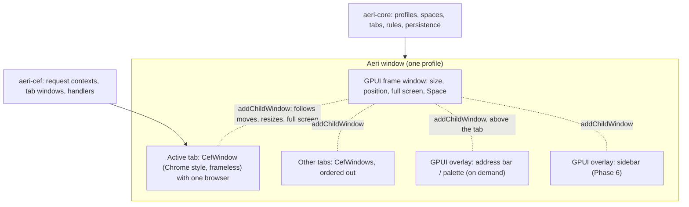
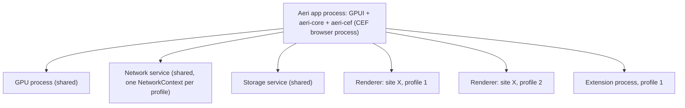

# Aeri architecture overview

Status: Phase 0, derived from the approved blueprint
(`.monozukuri/blueprint/01`–`04`) and ADRs 0001–0005. Nothing here is
implemented yet. Anything that depends on a spike is marked *(S#)*.

## Product summary

Aeri is an open-source desktop browser. It is written in Rust. Its interface
is drawn with GPUI. Its web engine is Chromium, embedded through CEF
([ADR 0001](../decisions/0001-browser-engine.md)).

- Pages load as they do in Chrome, and Chrome Web Store extensions run.
- The page fills the window. The sidebar and address bar slide over it.
- Each profile is an isolated identity with its own storage
  ([profile-isolation.md](profile-isolation.md)).
- Nothing leaves the machine unless the Person starts it. There is no
  telemetry.
- The first target is Apple Silicon on macOS 14+. Windows follows the macOS
  beta ([roadmap](../roadmap.md)).

## The four layers

The handoff ([`docs/handoff.md`](../handoff.md) §2.2) defines four layers.
The workspace maps them to crates as follows.

| Layer | Responsibility | Crate or binary | Depends on |
| --- | --- | --- | --- |
| A. Native interface | Windows, sidebar, address bar, palette, menus, shortcuts, themes, animation | `apps/aeri` (`app::shell`, `app::theme`) | GPUI, `aeri-core` |
| B. Browser core | Tab and space state, profiles, session, history, bookmarks, settings, rules | `crates/aeri-core` | `rusqlite`, `serde`; **no GPUI, no CEF** |
| C. Chromium integration | Browsers, request contexts, handlers, crash detection | `crates/aeri-cef` | `cef` crate, `aeri-core` |
| D. Platform integration | Menus, Keychain, file dialogs, notifications, appearance, packaging | `apps/aeri` (`app::platform`), `scripts/` | `objc2`, `keyring-core` |

`apps/aeri-helper` is a fifth, small binary. It is Chromium's subprocess
entry point plus Aeri's renderer-side hooks (cosmetic filtering, later form
detection). It belongs to layer C.

Rules that keep the layers apart:

- `aeri-core` never imports GPUI or a CEF type. It is unit-testable alone.
- `aeri-cef` is the only crate that touches CEF.
- `apps/aeri` talks to the engine only through the engine seam (below).
- More crates are added only when an ownership boundary appears
  (handoff §9).

## Window model (macOS)

Each Aeri window is one profile. A GPUI frame window owns the window's size,
position, full screen and Space. Each tab is its own frameless Chrome-style
CEF window, attached as a child window that covers the frame. Only the
active tab's window is ordered in. GPUI overlays (address bar, later the
sidebar and palette) are child windows above the page
([ADR 0002](../decisions/0002-rendering-strategy.md), "S1 outcome"). Why
this shape is forced is in [gpui-cef-integration.md](gpui-cef-integration.md).



Chrome's own UI (extension popups, Web Store install prompt, permission and
passkey sheets) is positioned by Aeri but not drawn by it.

## Process model

One Aeri app process runs the CEF browser process, GPUI and `aeri-core`.
Chromium adds helper processes. Many profiles and windows share this one
tree. A second launch hands its request to the running app, because CEF
holds a process-singleton lock on the root cache path
([cef.md §5](../research/cef.md)).



- Helpers are launched from `aeri-helper` bundles
  ([cef.md §8](../research/cef.md)).
- Renderers are never shared between profiles. The same site open in two
  profiles uses two renderers ([cef.md §5](../research/cef.md)).
- The GPU, network and storage processes are shared. Process counts with
  many profiles are unmeasured (spike S4).
- Main thread: GPUI owns `[NSApp run]`. CEF runs with an external pump. See
  [gpui-cef-integration.md](gpui-cef-integration.md).
- History is written on a per-profile writer thread with its own
  connection. The workspace snapshot is written on the main thread, at most
  once a second after a change (and at once on quit or last-window close).

## Engine seam

`aeri-core` defines the engine interface. `aeri-cef` implements it. No CEF
type crosses into `aeri-core` or the UI
([02-tech-stack.md](../../.monozukuri/blueprint/02-tech-stack.md), "Engine
seam").

| Direction | Items |
| --- | --- |
| Commands (core → engine) | create browser, close browser, navigate, go back, go forward, reload, stop, rest, show |
| Events (engine → core) | load state, title, favicon, navigation entries, crash, popup request, permission request, download, certificate error |

Rest means: record the URL, title and navigation entries, close the
browser, and recreate it on first show. CEF has no discard API
([cef.md §6](../research/cef.md)).

## Data layout

Root: `~/Library/Application Support/Aeri/` on macOS,
`%LOCALAPPDATA%\Aeri\` on Windows ([ADR 0004](../decisions/0004-profile-storage.md)).

| Path | Content |
| --- | --- |
| `app.db` | Profile list, appearance, themes, shortcuts, filter-list metadata, window placement |
| `Profiles/<profile-id>/profile.db` | Spaces, tabs, trails, closed tabs, history, bookmarks, site settings, downloads, password-provider choice |
| `Chromium/` | CEF `root_cache_path`. Not used as a profile. |
| `Chromium/<profile-id>/` | That profile's cookies, cache, site data, extensions |
| (no `Blocking/`) | Blocking is uBlock Origin Lite's, inside each profile's Chromium storage ([ADR 0008](../decisions/0008-blocking-through-ublock-origin-lite.md)) |

Profile ids are UUID v7. Migrations are numbered SQL applied at open. Details
and deletion rules are in [profile-isolation.md](profile-isolation.md).

## Where to find things

| What | Where |
| --- | --- |
| Why each major choice was made | [`docs/decisions/`](../decisions/) (ADRs 0001–0005) |
| Evidence (Observed / Reported / Inferred) | [`docs/research/`](../research/): `cef.md`, `gpui.md`, `blocking-and-credentials.md`, `codecs-drm.md`, `wkwebview.md`, `webview2.md` |
| Requirements, stack, stack map, phase plan | [`.monozukuri/blueprint/`](../../.monozukuri/blueprint/) |
| Phases and spikes | [`docs/roadmap.md`](../roadmap.md) |
| Build and contribute | [`docs/development.md`](../development.md) |

## Workspace layout

```
apps/aeri/          the binary: GPUI windows and views, macOS glue
apps/aeri-helper/   CEF subprocess binary (renderer hooks)
crates/aeri-core/   domain model, rules, persistence; no GPUI, no CEF
crates/aeri-cef/    CEF adapter for the engine seam
```

These are created in Phase 1 (planned).
